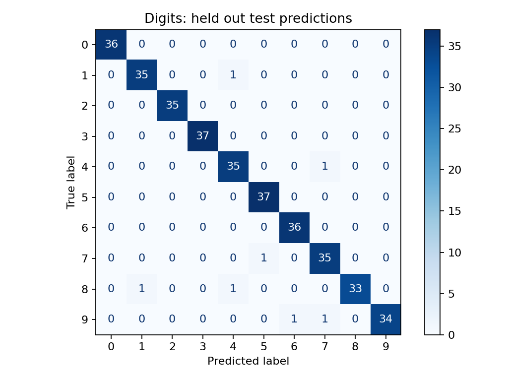
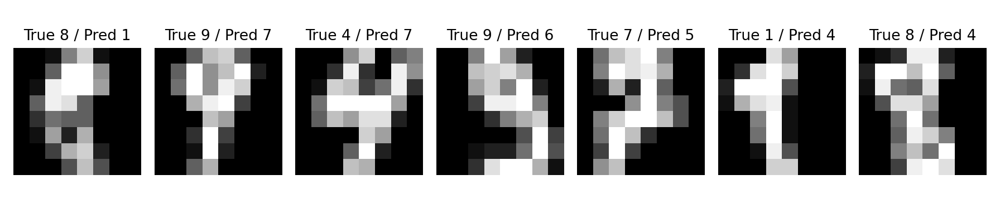

# Handwritten Digit Classification

An educational AI portfolio project prepared for Moamen Dahshan with AI assistance.

## Method and limitations

Uses scikit learn’s bundled 8 by 8 handwritten digit dataset. Scaling is fitted within the training pipeline. Five fold cross validation uses training data only; the final test set is held out. C is fixed, not tuned on the test set. Random stratification does not guarantee writer independent evaluation. This is a small classical computer vision benchmark, not a production OCR service.

## Run

Python 3.11 or newer recommended. From this folder:

```bash
python -m venv .venv
# Activate the environment for your operating system
python -m pip install -r requirements.txt
python train.py
```

Results and plots are written to `results/`. Random seed: 42. Dependency and platform differences can affect results. No dataset downloads or API keys are required.

## Source

[Official scikit learn documentation](https://scikit-learn.org/stable/modules/generated/sklearn.datasets.load_digits.html)

## Development notes

Code and documentation were prepared with AI assistance. This is a new portfolio demonstration, not an earlier employment or competition achievement. Review and understand the workflow before presenting it as personal expertise.

## Recorded run

```json
{
  "train_samples": 1437,
  "test_samples": 360,
  "cv_accuracy_mean": 0.9798223964382501,
  "cv_accuracy_std": 0.006369014139636586,
  "test_accuracy": 0.9805555555555555,
  "macro_f1": 0.9805015284652674,
  "baseline_accuracy": 0.1
}
```




